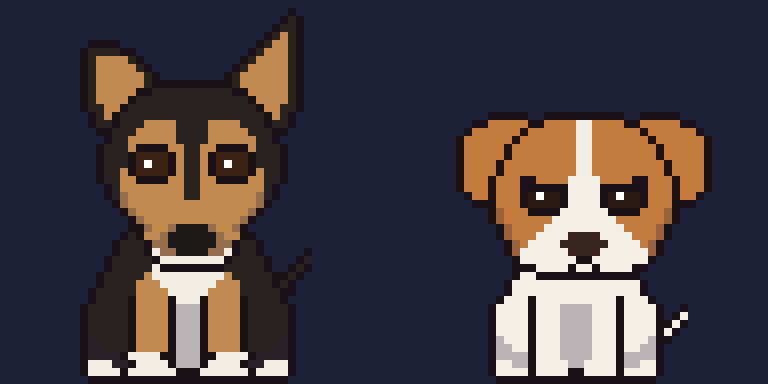

# pets 🐶🐶

Dois mascotes em pixel art 8-bit que avisam sobre progresso de tarefas,
problemas e notificações importantes — com animações e falas. Primeiro rodam
num simulador no PC; depois, numa telinha controlada por um microcontrolador
(ESP32).

Os mascotes de referência são **Simba** e **Nala**, mas o projeto é um motor
genérico: qualquer pessoa pode **criar os próprios pets** descrevendo as
características num arquivo de configuração. A partir dele, os sprites e as
animações são gerados.

<p align="center"></p>

> Projeto em construção. Veja [`docs/arquitetura.md`](docs/arquitetura.md) e
> [`docs/tecnologias.md`](docs/tecnologias.md).

## Gerando os sprites

```bash
python -m venv .venv
.venv/Scripts/activate        # Linux/macOS: source .venv/bin/activate
pip install -r requirements.txt
python -m tools.petgen        # ou: python -m tools.petgen simba
```

Saídas em `build/`:

| Arquivo | O que é |
|---|---|
| `sprites/<id>.png` + `.json` | spritesheet 48×48 + metadados no formato do Aseprite (tags = animações) |
| `preview/<id>_<anim>.gif` | preview ampliado de cada animação |
| `preview/<id>_quadros.png` | todos os quadros ampliados, para revisão |
| `preview/todos.gif` | todos os pets lado a lado |

## Simulador

```bash
python -m sim            # janela 240x240 (ampliada 3x); --demo dispara eventos sozinho
```

Com o simulador aberto, qualquer script pode mandar eventos:

```bash
python -m sim.enviar erro "3 testes falharam"      # Simba (papel: alerta) avisa
python -m sim.enviar sucesso "build ok"            # Nala (papel: progresso) comemora
python -m sim.enviar aviso "disco cheio" --prioridade alta   # interrompe a fala atual
```

Ou por HTTP, de qualquer linguagem:

```bash
curl -X POST http://127.0.0.1:8765/evento -d '{"evento":"pendente","detalhe":"revisar o PR #12","pet":"auto"}'
```

| Campo | Valores |
|---|---|
| `evento` | `erro`, `aviso`, `pendente`, `deploy`, `sucesso`, `progresso`, `marco`, `info` |
| `detalhe` | texto que entra na fala (`{detalhe}` em `falas.toml`) |
| `pet` | `auto` (escolhe pelo papel), `ambos` ou o id do pet |
| `prioridade` | `baixa`, `normal`, `alta` (alta interrompe a fala atual) |
| `valor` | (só `progresso`) 0–100, mostra a barra no painel |
| `silencioso` | `true` = só atualiza o painel, sem fala (bom para progresso frequente) |

Quando ninguém está falando, a parte de cima da tela vira um **painel**: relógio,
tarefa em andamento com barra de progresso e o último evento. O layout se
adapta ao tamanho da tela (`--largura`/`--altura`): os pets usam a maior escala
inteira que cabe.

Teclas na janela: `1`–`7` disparam eventos de exemplo, `0` faz os dois falarem,
`S` salva uma captura em `build/sim.png`, `Esc` sai.

## Criando o seu pet

1. Copie `pets/nala/` para `pets/<seu_pet>/`.
2. Edite o `pet.toml`: porte, orelhas, focinho, olhos, padrão da pelagem,
   cores e personalidade. As variantes disponíveis são os arquivos em
   `art/templates/cachorro/` (ex.: `orelha/semi_caidas.txt` → `orelhas = "semi_caidas"`).
3. Rode `python -m tools.petgen <seu_pet>`.

Faltou uma variante? Os templates são grades de texto (um caractere por pixel,
legenda em `art/templates/cachorro/legenda.toml`). Contribuições são bem-vindas!

## Estrutura

```
pets/<id>/      pacote de cada pet (pet.toml, falas, overrides, extras)
art/templates/  templates base da pixel art (partes em camadas, em texto)
sim/            simulador no PC (pygame-ce) + API HTTP de eventos
firmware/       firmware do microcontrolador (PlatformIO + LovyanGFX)
tools/          gerador de sprites a partir do pet.toml + conversores (→ C)
docs/           documentação
build/          saídas geradas (ignorada pelo git)
reference/      fotos de referência — IGNORADA pelo git, nunca é commitada
```

## Licença

[MIT](LICENSE)
