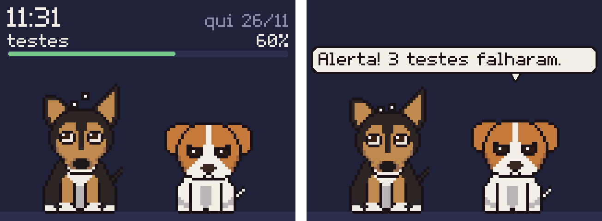
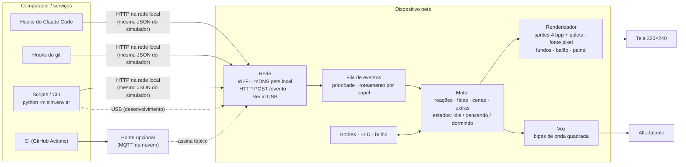
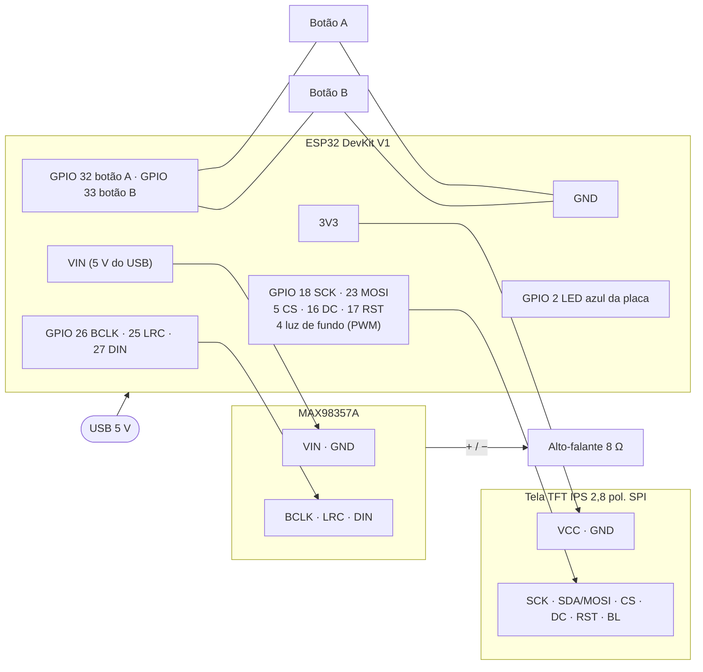
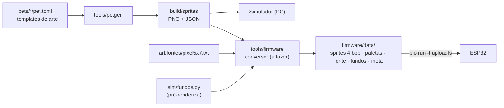

# Hardware — visão inicial

Primeira versão do dispositivo físico: uma telinha de mesa onde os pets vivem,
ligada por USB e recebendo eventos pelo Wi-Fi. É uma proposta para começar a
comprar e montar, e pode mudar conforme o firmware evoluir.

*O simulador já roda nesse formato: `python -m sim --largura 320 --altura 240`.*

## Decisões

| Item | Escolha | Por quê |
|---|---|---|
| Microcontrolador | **ESP32 DevKit V1** (ESP32-WROOM-32: 4 MB de flash, 520 KB de RAM, sem PSRAM). ✅ **Já temos** | Wi-Fi e dois núcleos. A RAM é suficiente se a tela for desenhada com cores indexadas (ver orçamento de memória). Se um dia faltar memória, o caminho é o ESP32-S3 N16R8, com a mesma arquitetura e outra configuração de pinos |
| Tela | **TFT IPS 2,8" 320×240, interface SPI** (controlador ST7789 ou ILI9341) | Paisagem: os pets ficam embaixo e o painel ou balão em cima, como no simulador. IPS mantém as cores da pixel art em qualquer ângulo |
| Som | **Amplificador I2S MAX98357A** + alto-falante pequeno de 8 Ω | Os bipes de "voz" saem limpos e com volume controlado por software. Um buzzer piezo soaria estridente e com um tom só |
| Entrada | **2 botões** | **A**: dispensa a fala ou vai para a próxima página. **B**: modo silencioso (toque) ou soneca (segurar) |
| Luz de aviso | **LED azul da própria placa** (GPIO 2). Opcional: um LED RGB WS2812 | Pisca num padrão diferente para cada tipo de evento, mesmo quando você não está olhando para a tela. Com o LED RGB, ganha cor também |
| Energia | **USB, 5 V** (porta do PC ou carregador de celular de 1 A ou mais) | É um aparelho de mesa, então dispensa bateria |
| Firmware | PlatformIO + Arduino + **LovyanGFX** + ArduinoJson + WiFiManager | DMA na SPI, cores indexadas e suporte às duas famílias de tela. O firmware fica em [`firmware/`](../firmware) |

## Arquitetura do sistema

- **Mesmo protocolo e mesma porta do simulador.** `POST /evento` na porta 8765, com `{"evento", "detalhe", "pet", "prioridade", "valor"}`. Tudo o que hoje fala com o simulador fala igual com o aparelho: basta usar `--host pets.local`.
- **Serial USB.** Aceita o mesmo JSON, uma linha por evento. Serve para desenvolver e para usar o aparelho sem Wi-Fi.
- **Eventos da nuvem.** A CI no GitHub não enxerga a sua rede local. Para ela, o aparelho assina um tópico MQTT (ponte opcional, fase 2).
- **Wi-Fi sem segredo no código.** No primeiro uso, o aparelho abre a rede `pets-config` com um portal de configuração (WiFiManager). A senha fica só na flash do aparelho.

## Ligações dos componentes

### Tabela de pinos

| Componente | Pino do componente | ESP32 DevKit V1 | Observação |
|---|---|---|---|
| Tela | VCC | 3V3 | |
| | GND | GND | |
| | SCK / SCL | GPIO 18 | SPI (VSPI) |
| | SDA / MOSI / SDI | GPIO 23 | SPI (VSPI) |
| | CS | GPIO 5 | |
| | DC / RS | GPIO 16 | |
| | RST / RESET | GPIO 17 | |
| | BL / LED | GPIO 4 | Brilho por PWM. Se o módulo não tiver transistor na luz de fundo, ligue no 3V3 |
| | MISO / SDO | (não ligar) | A tela só recebe dados |
| | T_* (toque) | (não ligar por enquanto) | Só existe nas versões com toque |
| MAX98357A | VIN | VIN (5 V) | Mais volume e menos ruído do que no 3V3 |
| | GND | GND | |
| | BCLK | GPIO 26 | |
| | LRC (WS) | GPIO 25 | |
| | DIN | GPIO 27 | |
| | SD / GAIN | (não ligar) | Ligado, mono, ganho de 9 dB |
| Botão A | um lado / outro lado | GPIO 32 / GND | *Pull-up* interno, sem resistor |
| Botão B | um lado / outro lado | GPIO 33 / GND | |
| *Opcional:* LED RGB WS2812 | DIN · VCC · GND | GPIO 13 · 3V3 · GND | Luz de aviso colorida |
| *Opcional:* sensor de luz BH1750 | SDA · SCL · VCC · GND | GPIO 21 · GPIO 22 · 3V3 · GND | Brilho automático |

Pinos a **evitar** na DevKit V1:
- **6 a 11**: memória flash.
- **0, 12 e 15**: pinos de *strapping*. O 12 em nível alto no boot trava a placa.
- **1 e 3**: serial USB.
- **34 a 39**: só entrada, sem *pull-up* interno.

O GPIO 2 (LED da placa) e o GPIO 5 (CS da tela) também são de *strapping*, mas funcionam bem nessas funções.

## Orçamento de memória e desempenho

O ESP32 da DevKit V1 não tem PSRAM. Com o Wi-Fi ligado, sobram cerca de 160–200 KB de RAM livre, então um *framebuffer* RGB565 da tela inteira (150 KB) não cabe com folga. A saída é desenhar com **cores indexadas**: a pixel art usa poucas cores, e cada pixel vira 1 byte.

| Recurso | Tamanho | Onde fica |
|---|---|---|
| *Framebuffer* 320×240 indexado (8 bits/pixel, paleta de até 256 cores) | 75 KB | RAM |
| Conversão para RGB565 e envio à tela | Em faixas pequenas, por DMA | RAM (≈ 2 × 6 KB) |
| Sprites dos 2 pets (≈ 256 quadros 48×48, 4 bits/pixel + paleta) | ≈ 300 KB | Flash (LittleFS) |
| Fonte pixel (152 glifos) | < 4 KB | Flash |
| Fundos especiais pré-renderizados (baixa resolução, ~24 quadros, 4 bpp) | ≈ 60–100 KB cada | Flash |
| Tela inteira pela SPI a 40 MHz | ≈ 31 ms por quadro | Atualizando só a área que mudou, fica bem mais rápido |

A flash de 4 MB é dividida em 1,9 MB para o firmware e 2 MB para os arquivos dos pets (`firmware/particoes.csv`). A pixel art anima a 5–10 quadros por segundo, então sobra folga.

### Assets: uma única fonte de verdade

O firmware lê os pets de arquivos no LittleFS, sem nada compilado dentro dele. Quem cria o próprio pet só gera os assets e grava a partição de arquivos, sem recompilar.

## Lista de compras

Os preços são **estimativas** de lojas brasileiras e marketplaces (Mercado Livre, Magalu, AliExpress) e variam bastante. Compare antes de fechar.

### Essencial

| # | Item | Qtd | Como procurar / o que conferir | Faixa (R$) |
|---|---|---|---|---|
| 1 | ~~ESP32~~ **DevKit V1** | 1 | ✅ **Já temos** (era da tomada inteligente) | — |
| 2 | **Tela TFT 2,8" 320×240 SPI** (IPS de preferência) | 1 | "ST7789 2.8 240x320 SPI IPS" ou "ILI9341 2.8 SPI". Ela **precisa ter pinos SPI** (VCC, GND, CS, RESET, DC, SDI/MOSI, SCK, LED). **Não compre** o *shield* de Arduino UNO, que usa interface paralela de 8 bits. Versão com toque serve, mas o toque é dispensável | 60 – 130 |
| 3 | **Amplificador I2S MAX98357A** | 1 | "MAX98357A I2S 3W" | 15 – 40 |
| 4 | **Alto-falante 8 Ω, 0,5–2 W**, 28–40 mm | 1 | "alto falante 8 ohm 1W 40mm". Os que vêm com fio e conector JST facilitam | 8 – 20 |
| 5 | **Botões táteis** 6×6 ou 12×12 mm | 2 (compre um pacote) | "push button tátil 12x12" (com capinha fica mais bonito) | 5 – 15 |
| 6 | **Protoboard 830 pontos** | 1 | Para montar e testar sem soldar. A DevKit V1 é larga: numa protoboard só sobra uma fileira de furos de um dos lados. Duas protoboards lado a lado resolvem | 15 – 30 |
| 7 | **Jumpers** macho-macho e macho-fêmea | 1 kit de cada | 20 cm | 15 – 30 |
| 8 | **Cabo micro-USB de dados** | 1 | Provavelmente já tem. Precisa transmitir dados, não só carregar | 10 – 20 |

**Total do essencial (sem a placa): ≈ R$ 130 – 285.**

### Opcional

| Item | Para quê | Faixa (R$) |
|---|---|---|
| **LED RGB WS2812** (avulso ou módulo de 1 LED) | Luz de aviso colorida: vermelho no erro, amarelo no aviso | 5 – 15 |
| Sensor de luz **BH1750** | Brilho automático, com a tela escurecendo à noite | 10 – 25 |
| **Placa perfurada** 5×7 cm + barras de pinos fêmea | Versão definitiva soldada, com os módulos encaixáveis | 10 – 20 |
| **Ferro de solda** + estanho | Para a placa perfurada | 60 – 150 |
| **Caixinha impressa em 3D** (uma casinha de cachorro?) | Acabamento. O modelo pode entrar no repositório depois | variável |

## Montagem, em etapas

0. **Só a placa (já dá para fazer).** O firmware recebe eventos pelo Wi-Fi (`pets.local`) e pela serial USB, mantém a fila com prioridades e pisca o LED azul num padrão por tipo de evento. Ver [`firmware/README.md`](../firmware/README.md).
1. **Protoboard.** Tela, amplificador e botões ligados com jumpers. Pets em idle e falas na tela.
2. **Experiência completa.** Animações, cenas, extras, voz e painel, iguais aos do simulador.
3. **Versão definitiva.** Placa perfurada com os módulos encaixáveis e uma caixinha.
